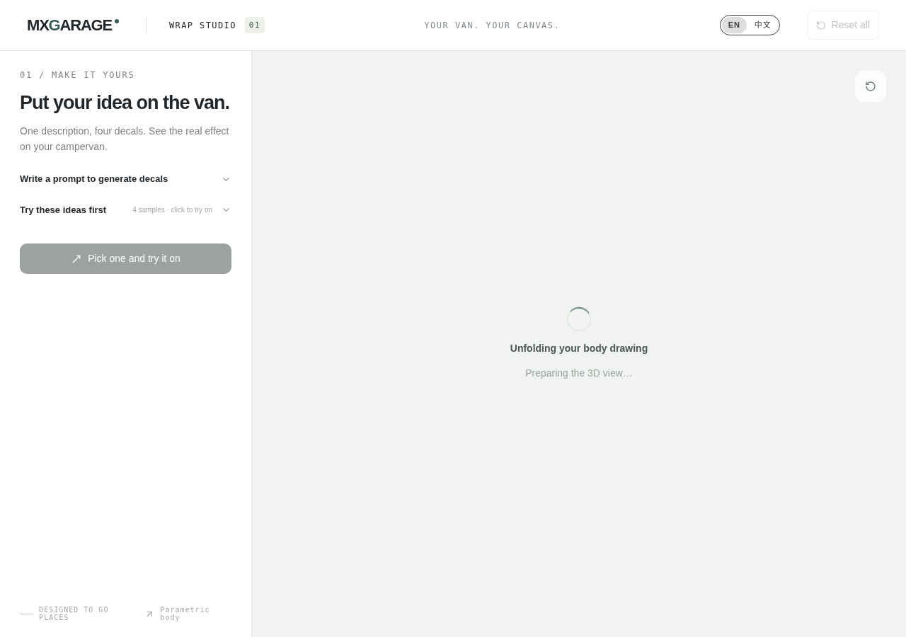

# PR #23 bounded return validation — INCONCLUSIVE

Claim: `vss-21-nav-gpt-20261025-01`. Implementation: `d71bc12213f28afe7ba1310881b7d5585f0cfeed`. Rules baseline: main `20aee5d1136bcfbec9b2a992aa5fbdfa25ff9eaf` constitution.md, AGENTS.md, CONTRIBUTING.md, read through `git show`. Coordination comment read before execution: https://github.com/shengjun89/van-sticker-studio/pull/23#issuecomment-6402310794 . HEAD matched the implementation SHA and `git status --porcelain` was empty before this run.

## Intended terminal criteria and budget

Success required all of: home `.reset-all` enabled (the existing page sets `ready` from VehicleScene.onReady); `.model-loading` absent; no visible `.model-error`; a nonzero canvas; and successful completed responses for both `/model/mxgarage-rv.glb` and `/model/motion_metadata.json`. URL arrival alone did not qualify.

An explicit visible model error, a critical model request failure/non-success HTTP response while dwelling, a `Vehicle load failed` console error while dwelling, or an uncaught page error would stop the flow as failure. No terminal within 60 seconds would stop as inconclusive. One context, one initial body-lab visit, one return-link activation; only first success would permit one Back and one Forward. Zero reloads or retries.

## Actual execution

- Standard unchanged `npm run dev` started on localhost:3000. No owner-private identity or secret file was inspected, and no configuration was modified. Dev output was sanitized as it was written to `dev.log`.
- `node /tmp/vss-21-nav-evidence/bounded-return/bounded-return.cjs`: exit **2**, outcome **inconclusive**.
- Started 2026-10-25T19:48:59.507Z; finished 19:49:06.892Z; elapsed 7,385 ms.
- Actual counts: one browser context, one initial `/body-lab` visit, one return-link activation, zero Back, zero Forward, zero reload, zero retry.
- The test harness called its first DOM snapshot while navigation was replacing the execution context. Playwright raised `page.evaluate: Execution context was destroyed, most likely because of a navigation`. The full recorded stack is in `result.json` and `run.log`.
- This harness error stopped the run before any model readiness/failure terminal was established. No automatic retry or revised browser run was attempted.
- The recorded navigation did reach `/`. The saved project-only screenshot `stopped-inconclusive.png` shows the home page still displaying “Unfolding your body drawing / Preparing the 3D view…”, with Reset all disabled. It is a stopped intermediate state, **not** a successful or failed model terminal.
- No model/metadata requests had been recorded before shutdown. No requestfailed or `Vehicle load failed` event was recorded in this run. This absence does not prove that home loading would succeed or that the earlier errors were normal cancellations.
- Back/Forward was not executed because first success was not established. The intended dwell-to-terminal and Back/Forward coverage therefore remain incomplete.

## Evidence and boundaries

- `timeline.jsonl`: timestamped sanitized request, response, requestfinished/requestfailed, navigation, console, and shutdown events. Only paths, methods, status, resource type, and event metadata are recorded; no request headers, credentials, response bodies, or URL query strings.
- `result.json`: complete structured outcome, counts, request records, timeline, and harness exception.
- `run.log`, `run.exit`: exact test result and exit code.
- `stopped-inconclusive.png`: project page at stop, 1280x900. No desktop, account, or configuration is shown.
- `dev.log`, `dev.exit`: sanitized standard dev output. The owned dev process was stopped after the bounded run; the standard dev command exited 0.

Only temporary evidence files were written. No repository source, tests, screenshots from earlier runs, configuration, model, or renderer was modified. No AI generation, lead submission, paid endpoint, deployment, Git commit/push/comment, or independent code review was performed.

The exact blocked action was reading a DOM snapshot during document navigation; it failed with a Playwright execution-context error, not an approval denial. The application model result is uncertain and remains **inconclusive**. The previous `Failed to fetch` cause remains unproven. This run provides no basis to attribute that error to PR #23 or to dismiss it as normal cancellation. Maintainer visual acceptance remains outstanding. Financial cost is not exposed by the environment.

## Saved-evidence-only timing analysis

This section was produced only by reading the existing `result.json`, `timeline.jsonl`, and `stopped-inconclusive.png`. No page was reopened and no script was changed or rerun.

| UTC time on 2026-10-25 | Elapsed ms | Direct recorded event |
|---|---:|---|
| 19:49:04.123 | 4,616 | First home/return phase starts; one link activation budget consumed. |
| 19:49:04.195 | 4,688 | GET `/` document request starts, request ID 15. |
| 19:49:06.637 | 7,129 | `/` document response HTTP 200. |
| 19:49:06.649 | 7,141 | First and only harness error: `page.evaluate: Execution context was destroyed, most likely because of a navigation`. |
| 19:49:06.663 | 7,155 | Main-frame navigation records `/`. |
| 19:49:06.676 | 7,169 | `/` document `requestfinished`, HTTP 200. |
| 19:49:06.698 | 7,190 | Home document `domcontentloaded`. |
| 19:49:06.715 | 7,208 | Home document `load`. |
| 19:49:06.805 | 7,297 | Main frame again records `/`. |
| 19:49:06.815 | 7,308 | Shutdown phase starts with outcome inconclusive. |
| 19:49:06.828 | 7,321 | Page close event. |
| 19:49:06.892 | 7,385 | Run finished and result saved. |

The screenshot was saved in the exception handler between the harness error and shutdown. Its pixels show the **home page**, including “Put your idea on the van.”, the disabled Reset all button, and the model-loading UI. They do not show the model, an enabled ready control, or the explicit model-error panel. An exact screenshot capture timestamp was not recorded, so none is invented.

The saved sequence contains 266 requests, 265 responses, 265 requestfinished events, zero requestfailed events, zero browser console-error events, and zero pageerror events. No `/model/` or `/api/` request appears. One script request (`/app/page.tsx`, ID 264, started at elapsed 7,299 ms) has no response, finished, or failed event in the saved observation window. There is no recorded cancellation timestamp or requestfailed signal to classify; absence of such an event is not proof that no cancellation occurred after closing.

Consequently neither model-ready nor a definite model-error terminal is directly established. The document's HTTP 200/finished and document load events prove document delivery only. The harness error is distinct from the earlier application `Vehicle load failed` messages: those messages did **not** occur in this bounded trace. Their earlier cause remains unproven. Outcome remains **inconclusive**; no Back/Forward or second attempt was executed.

## Sanitized relevant timeline excerpt

Extracted from the recorded timeline without reopening the browser. Dependency-module request noise is omitted; document, model, warning/error and shutdown events are retained. Repeated main-frame events are observed events, not additional scripted reloads; their cause was not established.

```jsonl
{"at": "2026-10-25T19:49:00.023Z", "elapsedMs": 516, "phase": "body_lab_initial", "type": "phase_started"}
{"at": "2026-10-25T19:49:00.039Z", "elapsedMs": 532, "phase": "body_lab_initial", "type": "request", "id": 1, "path": "/body-lab", "method": "GET", "resourceType": "document", "startedMs": 532, "status": null, "finished": false}
{"at": "2026-10-25T19:49:03.633Z", "elapsedMs": 4126, "phase": "body_lab_initial", "type": "response", "id": 1, "path": "/body-lab", "status": 200}
{"at": "2026-10-25T19:49:03.640Z", "elapsedMs": 4133, "phase": "body_lab_initial", "type": "main_frame_navigated", "path": "/body-lab"}
{"at": "2026-10-25T19:49:03.653Z", "elapsedMs": 4146, "phase": "body_lab_initial", "type": "requestfinished", "id": 1, "path": "/body-lab", "status": 200}
{"at": "2026-10-25T19:49:04.056Z", "elapsedMs": 4549, "phase": "body_lab_initial", "type": "domcontentloaded", "path": "/body-lab"}
{"at": "2026-10-25T19:49:04.123Z", "elapsedMs": 4616, "phase": "home_first", "type": "phase_started"}
{"at": "2026-10-25T19:49:04.142Z", "elapsedMs": 4635, "phase": "home_first", "type": "load", "path": "/body-lab"}
{"at": "2026-10-25T19:49:04.195Z", "elapsedMs": 4688, "phase": "home_first", "type": "request", "id": 15, "path": "/", "method": "GET", "resourceType": "document", "startedMs": 4688, "status": null, "finished": false}
{"at": "2026-10-25T19:49:05.015Z", "elapsedMs": 5508, "phase": "home_first", "type": "main_frame_navigated", "path": "/body-lab"}
{"at": "2026-10-25T19:49:05.937Z", "elapsedMs": 6430, "phase": "home_first", "type": "main_frame_navigated", "path": "/body-lab"}
{"at": "2026-10-25T19:49:06.197Z", "elapsedMs": 6689, "phase": "home_first", "type": "console", "level": "warning", "text": "[.WebGL-0x1f84001bb000]GL Driver Message (OpenGL, Performance, GL_CLOSE_PATH_NV, High): GPU stall due to ReadPixels"}
{"at": "2026-10-25T19:49:06.221Z", "elapsedMs": 6714, "phase": "home_first", "type": "console", "level": "warning", "text": "[.WebGL-0x1f84001bb000]GL Driver Message (OpenGL, Performance, GL_CLOSE_PATH_NV, High): GPU stall due to ReadPixels"}
{"at": "2026-10-25T19:49:06.240Z", "elapsedMs": 6733, "phase": "home_first", "type": "console", "level": "warning", "text": "[.WebGL-0x1f84001bb000]GL Driver Message (OpenGL, Performance, GL_CLOSE_PATH_NV, High): GPU stall due to ReadPixels"}
{"at": "2026-10-25T19:49:06.254Z", "elapsedMs": 6747, "phase": "home_first", "type": "console", "level": "warning", "text": "[.WebGL-0x1f84001bb000]GL Driver Message (OpenGL, Performance, GL_CLOSE_PATH_NV, High): GPU stall due to ReadPixels (this message will no longer repeat)"}
{"at": "2026-10-25T19:49:06.637Z", "elapsedMs": 7129, "phase": "home_first", "type": "response", "id": 15, "path": "/", "status": 200}
{"at": "2026-10-25T19:49:06.663Z", "elapsedMs": 7155, "phase": "home_first", "type": "main_frame_navigated", "path": "/"}
{"at": "2026-10-25T19:49:06.676Z", "elapsedMs": 7169, "phase": "home_first", "type": "requestfinished", "id": 15, "path": "/", "status": 200}
{"at": "2026-10-25T19:49:06.698Z", "elapsedMs": 7190, "phase": "home_first", "type": "domcontentloaded", "path": "/"}
{"at": "2026-10-25T19:49:06.715Z", "elapsedMs": 7208, "phase": "home_first", "type": "load", "path": "/"}
{"at": "2026-10-25T19:49:06.805Z", "elapsedMs": 7297, "phase": "home_first", "type": "main_frame_navigated", "path": "/"}
{"at": "2026-10-25T19:49:06.815Z", "elapsedMs": 7308, "phase": "shutdown", "type": "phase_started", "outcome": "inconclusive"}
{"at": "2026-10-25T19:49:06.828Z", "elapsedMs": 7321, "phase": "shutdown", "type": "page_closed"}
```


