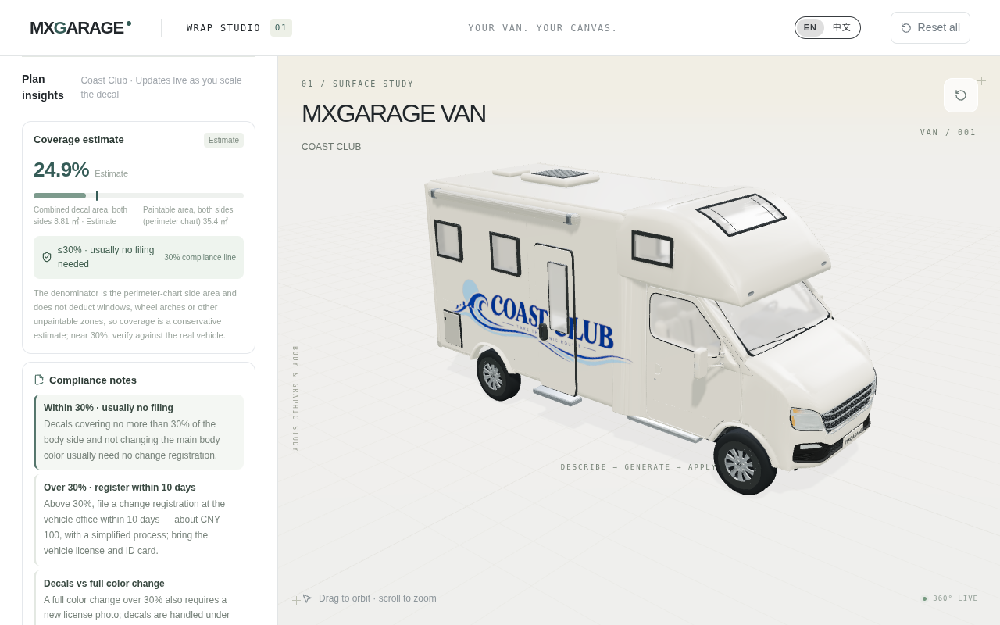
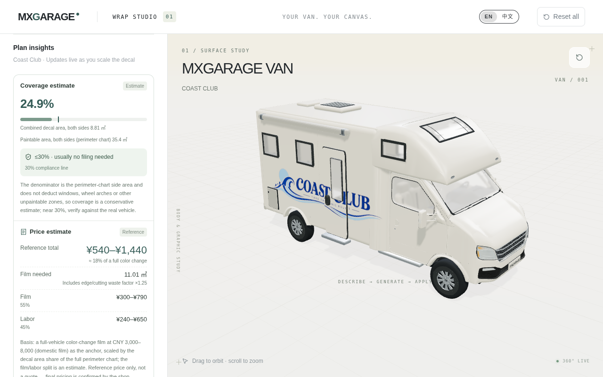
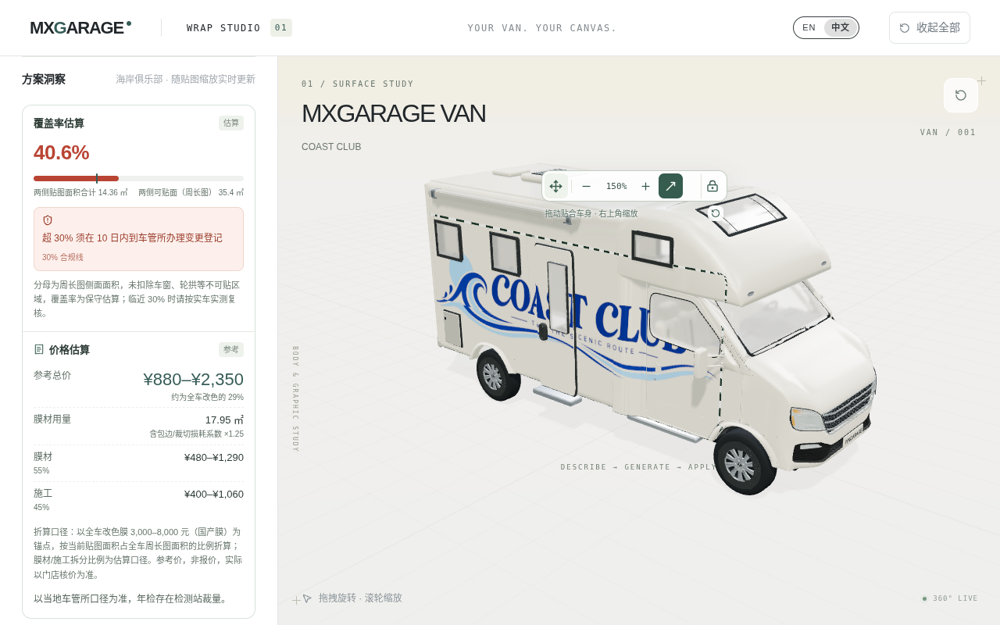
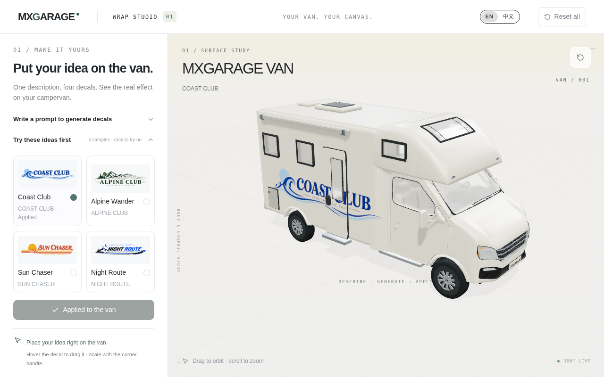
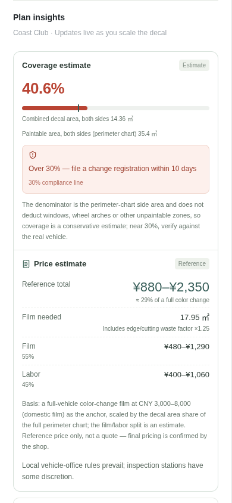

# PR #25 已有验收证据

执行者：GPT；角色：实现者；claim `vss-19-insights-gpt-20261025-01`。

本目录归档已完成的组件切片验证与原始项目截图，供父线程安排独立评审。此次补交不重跑产品扫描，不改产品代码或验收标准。

## 绑定的规则与授权

- main 基线：`20aee5d1136bcfbec9b2a992aa5fbdfa25ff9eaf`。
- 适用的是该提交的 [constitution.md](https://github.com/shengjun89/van-sticker-studio/blob/20aee5d1136bcfbec9b2a992aa5fbdfa25ff9eaf/constitution.md)、[AGENTS.md](https://github.com/shengjun89/van-sticker-studio/blob/20aee5d1136bcfbec9b2a992aa5fbdfa25ff9eaf/AGENTS.md)（§1 门禁、§3/§8 视觉证据、§6 交接、§7 边界）及 [CONTRIBUTING.md](https://github.com/shengjun89/van-sticker-studio/blob/20aee5d1136bcfbec9b2a992aa5fbdfa25ff9eaf/CONTRIBUTING.md)（§6 评审）。这里记录结果，不建立新 spec。
- 目标与排他范围：[Issue #19](https://github.com/shengjun89/van-sticker-studio/issues/19)、[原协调评论](https://github.com/shengjun89/van-sticker-studio/issues/19#issuecomment-6402150729)。
- 具体功能实现提交：`9f2400d929c1faa6a874a9107b3c11216ad67f07`，分支 `feature/19-insights-summary`。
- 此次证据目录权限：[PR #25 dot 协调评论](https://github.com/shengjun89/van-sticker-studio/pull/25#issuecomment-6402372521)。仅允许 `docs/reviews/pr-25/` 内的现有项目截图 PNG 与验收记录。
- 保持 Draft、Refs #19；整项未关闭，独立评审仍待父线程安排。

## 截图与上下文

五张均是既有浏览器截图，复制字节与原文件一致；画面仅有项目界面，无桌面、账号信息或私有配置。未重新截图，也未裁剪或修图。

### 同视角改前 / 改后

Coast Club 样例，相同相机与渲染模式，1280×800；侧栏滚到洞察顶部。它们证明组件呈现变化，不代表整页首屏验收通过。

改前：



改后：



### 中文缩放后的实际状态

1280×800；已拖动拉花并缩放，原生比例输出为 150%，覆盖率 40.6%，参考价 ¥880–¥2,350。该图与上面的默认比例场景不同。



### 未通过的整页首屏与窄屏边界

1280×800，应用样例后、样例列表展开且侧栏 scrollTop=0：摘要 top=856.28px，未完整出现在首屏。



390×844：整页 document/body 宽392px，既有页头 `.reset-all` 的右边界392.3125px；摘要自身宽345px，scrollWidth=clientWidth=345，子卡/折叠无自身横向溢出。页头问题仍需父级布局集成。



## 原始 Library 身份与校验

以下是原先上传成功时返回的实际 `library_file_id`，均保留版本 **0**。本次没有重新上传、创建副本或替换 Library 文件；仓库中的 PNG 只是相同字节的评审证据。

| 文件 | 尺寸 | 字节 | library_file_id | 版本 |
| --- | --- | ---: | --- | ---: |
| before-full-en.png | 1280×800 | 295054 | `libfile_b93f726c1f58819186b8a836f9a71af2` | 0 |
| after-full-en.png | 1280×800 | 287811 | `libfile_8dd4346e3e748191bf01c1edb0388802` | 0 |
| after-full-zh.png | 1280×800 | 315942 | `libfile_54175f36c3108191b9724f416a0c142f` | 0 |
| after-firstscreen-en.png | 1280×800 | 285204 | `libfile_da33d73e7f68819193830b512ff64152` | 0 |
| after-failure.png | 390×844 | 61524 | `libfile_6b7b5e78a0048191a5c85aa997831f4d` | 0 |

SHA-256：

```text
14f0fc524217c9973eae63e7b30444a62756d55ad82c1b6a00620d3d58426cc7  before-full-en.png
608df7a780abd444f293fa02ee67796ec9e555da72f04a09b4f1f58241cd949f  after-full-en.png
fc6debdbb0759998416fa9014c7f940fde1d089045c7d3439b0ee866140cb772  after-full-zh.png
b927568df80d188045120a427d2a2baa60b972d16f8bee572533db97a7977ad5  after-firstscreen-en.png
f1ed791009ae1db65047c3682b83b1d3335a65f1005a4b5906306b0b99690087  after-failure.png
```

## 已有验证结果（绑定功能实现 SHA）

以下均来自 `9f2400d929c1faa6a874a9107b3c11216ad67f07` 的原执行记录，本次证据提交未重跑产品测试或扫描。

| 命令 / 检查 | 退出码与结果 |
| --- | --- |
| 安装后基线 `npm test` | 0；108 pass / 0 fail |
| `node --experimental-strip-types --test tests/plan-insights-ui.test.ts`，旧实现 RED | 1；4 pass / 4 fail |
| 同命令，实现后 GREEN | 0；8 pass / 0 fail |
| 同命令，故意给 details 加 open | 1；6 pass / 2 fail；恢复原字节后0，8/8 |
| `npm run lint` | 0；0 error / 0 warning |
| `npm test`，最终 | 0；116 pass / 0 fail |
| `npx tsc --noEmit` | 0 |
| `npm run build` | 0；保留代理和 >500kB chunk 提示 |
| 同样例基线/当前真实 SSR 对比 | 0；中英 × coverage/price 四组数值一致，见 [原记录](same-sample-comparison.json) |
| `node /tmp/vss-19-evidence/after-functional.mjs` | 1；键盘/中英/缩放阶段通过，最终390px整页宽度断言失败，见 [原记录](after-functional.json) |
| `node /tmp/vss-19-evidence/move-proof.mjs` | 0；真实移动、缩放、状态保持和窄屏定位完成，见 [原记录](move-proof.json) |
| 原实现远端 CI | [run 40227801531](https://github.com/shengjun89/van-sticker-studio/actions/runs/40227801531) completed / success |

真实移动将 center1.95→2.422832、height1.28→1.439744，scale保持1；gizmo坐标也改变，覆盖率24.9%及参考价¥540–¥1,440保持不变。真实缩放后 DOM output=150%，覆盖率40.6%、参考价¥880–¥2,350、膜材17.95㎡；已展开详情保持展开。Enter / Space / Tab / Shift+Tab 与2px可见焦点通过，中英数值和免责声明一致。浏览器只观察到 GET /api/status，无生成 POST，pageerrors=[]。

`move-proof.json` 的 `after-scale.editor` 来自 React 内部 fiber，可能滞后一帧；最终缩放值以原生 DOM output 和显示数字为证，不把内部候选值当公开 API。中文 before 未捕获；before价格无直接 DOM 记录，前后对账依据是固定基线组件与当前组件的同 PNG 真实 SSR 对比。`before-insights-en.png` 是原滚动容器裁切长图，未收录为有效证据。

## 仍待集成与评审

- 1280×800 整页首屏未通过，摘要 top≈856px，依赖父级布局。
- 390px 整页页头横向溢出仍未通过，依赖父级布局。
- 产品组件、首页、i18n、global CSS、模型、生成 API、价格源、治理与流程 spec 均未因本次补交修改。
- 仍由父线程安排独立评审；只补证据，不批准自己的实现，不合并、部署或关闭整个 Issue。
